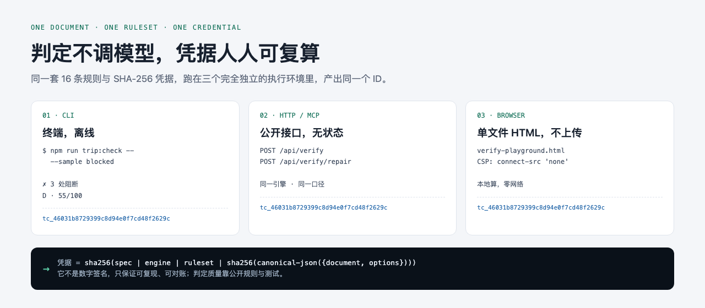

# travel-planner — Reproducible, deterministic verification for AI itineraries

[](https://github.com/1z5/travel-planner/actions/workflows/ci.yml)
[](LICENSE)
[](#quick-start)

> [中文文档](README.md) · [Live demo](https://travel-planner-demo.onrender.com) · [Architecture](docs/ARCHITECTURE.md) · [Open standard](docs/TRIP-CHECK-STANDARD.md)



An LLM can draft an itinerary in three minutes, but nobody is accountable for whether it
actually works. This repository is an engineering answer:

**turn the itinerary into a structured document, judge it with 16 deterministic rules
(no model calls), and issue a credential ID that anyone can independently recompute.**
No randomness, no wall-clock, no network in the judgment path — same document + same
ruleset version produces the same result on your machine and on mine.

> Status: a personal open-source project that is **both a GitHub showcase and a tool the
> author uses every day**. Not commercialized. The main app runs on Render with an external
> Postgres (itineraries survive restarts); the everyday mobile entry is a purely static,
> zero-cold-start verifier that can be added to the home screen and works offline.

## Verify once in 30 seconds

```bash
npm install
npm run trip:check -- --sample blocked
```

Output (excerpt, Chinese UI):

```
✗ [blocking] TC-C102 overlapping time slots   Suzhou Museum 09:00-12:00 overlaps Pingjiang Rd 11:30-13:00
✗ [blocking] TC-F204 opening-hours conflict   Suzhou Museum is scheduled on a Monday — closed
✗ [blocking] TC-F202 POI not found            "金鸡湖美术馆" does not exist in the declared fact source
i [info]     TC-C104 missing real leg data    2/2 adjacent pairs have no transit time; feasibility unknown

Consistency  D · 55/100     Facts  partial (POI 2/3 hit · routes 0/2)
Credential   tc_46031b8729399c8d94e0f7cd48f2629c   ← same document + options → same ID, for anyone
```

Add `--fix` for mechanical repair only (shift the timeline / drop same-day duplicates) with
**before & after credentials** — what changed and how much risk dropped, fully auditable:

```bash
npm run trip:check -- --sample blocked --fix
# before  tc_46031b87… (D · 55)  →  after  tc_ffb2639c… (A · 100)  ↑ +45 · blocking -1
```

Exit codes are CI-friendly: `0` pass · `1` blocking issues (`--strict` also fails on
warnings/unverified) · `2` invalid input. `--json` prints a machine-readable report; the
document format is a published [JSON Schema](docs/TRIP-CHECK-STANDARD.md).

## Three ways to use it

| Usage                | Entry point                                             | Notes                                                                                                       |
| -------------------- | ------------------------------------------------------- | ----------------------------------------------------------------------------------------------------------- |
| **CLI**              | `npm run trip:check -- <file.json>`                     | Zero keys, zero network, offline; verification and repair are deterministic                                 |
| **Offline verifier** | [verify-playground.html](public/verify-playground.html) | Single self-contained HTML: engine inlined, CSP blocks every outbound request, credentials computed locally |
| **Open API / MCP**   | `POST /api/verify` · `mcp/stdio.mjs`                    | Plug any agent/OTA itinerary into the same engine ([MCP](mcp/README.md))                                    |
| **Full web app**     | [Demo](https://travel-planner-demo.onrender.com)        | Grounded generation → check → workspace → share → in-trip mode                                              |

All three paths run the same `lib/verify/` engine and produce **the same credential ID**
(`tc_46031b87…`) for the same document. The browser build is not a simplified port —
judgment, repair and hashing are literally the same source files.
Use `#verified` / `#blocked` / `#unverified` to link straight to a finished result; once
deployed, `/verify-playground.html#blocked` on the demo site serves the same file (no API calls).

## On your phone

- **Live now**: <https://trip-check-verifier.app.workbuddy.host/?sharecode=EG2RWDAJZG>
  (static hosting, no instance, no cold start)
- **Permanent entry**: <https://1z5.github.io/travel-planner/> (GitHub Pages is enabled;
  `.github/workflows/pages.yml` publishes on every push)
- "Add to Home Screen" launches it full-screen; a same-origin Service Worker keeps the
  page available offline. Documents never leave the device (`connect-src 'none'`).
- `#blocked` links straight to a finished result with three blocking issues.

The main app handles generation, the workspace and in-trip mode. Its free Render instance
sleeps (kept warm every 5 minutes), but itineraries live in an external Postgres and do
not disappear on restart. See [DEMO.md](docs/DEMO.md).

## What this repo demonstrates

| Area                    | How                                                                                                                                 | Where                                                                                                                               |
| ----------------------- | ----------------------------------------------------------------------------------------------------------------------------------- | ----------------------------------------------------------------------------------------------------------------------------------- |
| Deterministic checks    | 16 pure-function rules + a two-axis report; no model in the judging path; reproducible credential IDs                               | `lib/verify/*` · [standard](docs/TRIP-CHECK-STANDARD.md)                                                                            |
| Recomputable proof      | canonical JSON + SHA-256, algorithm fixed in the public doc; CLI / API / MCP all produce the same ID                                | `lib/verify/credential.ts` (86 lines)                                                                                               |
| Reversible repair       | mechanical fixes only; preview → confirm write, `revision+1` optimistic concurrency, before/after credential chain                  | `lib/verify/repair.ts` · [ADR-005](docs/adr/005-deterministic-fix.md) · [ADR-013](docs/adr/013-trip-check-repair.md)                |
| Long-task orchestration | 2–4 min reasoning as async jobs with heartbeat self-healing; ≥5 days via outline → 3-way concurrent day streams → prefix publishing | `lib/jobs/jobs.ts` · `lib/plan/planner.ts` · [ADR-001](docs/adr/001-async-jobs.md) · [ADR-004](docs/adr/004-streaming-multi-day.md) |
| Hallucination control   | facts injected before generation; POI three-state `hit/miss/error`; unchecked means `unverified`, never faked                       | `lib/plan/grounding.ts` · `lib/geo/amap.ts` · [ADR-002](docs/adr/002-poi-three-state.md)                                            |
| Storage abstraction     | one Store interface, memory + postgres implementations, static fixture fallback, single read entry `resolvePlan`                    | `lib/store/` · `lib/plan/plan-repo.ts`                                                                                              |
| Contract engineering    | 33 API routes, unit tests + a custom e2e orchestrator (4 stubs / isolated ports / file lock), CI, git hooks                         | [ARCHITECTURE.md](docs/ARCHITECTURE.md) · [CONTRIBUTING.md](CONTRIBUTING.md)                                                        |
| Frontend                | ATLAS v6 dual-theme design system, React 19 View Transitions, scroll-driven CSS, zero new deps                                      | `app/styles/` · [ATLAS-V6](docs/design/ATLAS-V6.md)                                                                                 |

## Quick start

```bash
cp .env.example .env   # MOCK mode works without keys; LLM_* is needed for real generation
npm install
npx prisma generate    # required since Prisma 7 (no postinstall)
npm run dev            # http://localhost:3000
```

Open the home page and click the verified sample itinerary for an instant full artifact
(no LLM, no keys). With an Amap key, `npm run verify:amap` is a 5-second POI/transit smoke test.

## Reading path (20 minutes)

1. [docs/TRIP-CHECK-STANDARD.md](docs/TRIP-CHECK-STANDARD.md) — the open standard itself
2. [lib/verify/engine.ts](lib/verify/engine.ts) — the judging engine, 648 lines of pure functions
3. [lib/verify/rules.ts](lib/verify/rules.ts) — the 16-rule registry and penalty scale
4. [lib/verify/credential.ts](lib/verify/credential.ts) — the reproducible credential, 86 lines
5. [docs/ARCHITECTURE.md](docs/ARCHITECTURE.md) §7 — known technical debt (honest list)
6. [ADR-001](docs/adr/001-async-jobs.md) / [004](docs/adr/004-streaming-multi-day.md) / [005](docs/adr/005-deterministic-fix.md)

## Tests & gates

```bash
npm run gate          # typecheck + lint + format + unit + e2e
npm run test:unit     # Vitest unit tests
npm test              # e2e: 4 stubs + isolated dev servers, no external services
npm run gate:visual   # visual / accessibility regression
npm run check:env     # env drift / production safety check
```

Test counts are deliberately not hard-coded in docs — `npm run gate` is the source of truth
and CI runs the full chain on every push.

## Known boundaries (intentional)

- Credentials are reproducible hashes, **not digital signatures**; they are not an endorsement
  of the real world, and `unverified` never means "fine".
- Amap data is not stored long-term per the provider terms; this project is not used commercially.
- Persistence depends on an external Postgres (a broken connection fails loudly instead of
  silently falling back to memory); the free instance sleeps but itineraries survive restarts.
  Share tokens act as capabilities (no account system); quotas are per-instance.
- Transit is a driving-matrix estimate, not real transit routing; map lines are sequential, not navigation.
- Generation is slow (3–4 min for ≤4 days; day-streaming above that), absorbed by async jobs,
  progress reporting, and quota refunds.
- No error monitoring; failures only hit the console. This is not production-grade observability.

## License & contributing

[Apache-2.0](LICENSE) (Copyright © 2026 1z5) · [NOTICE.md](NOTICE.md) · [CONTRIBUTING.md](CONTRIBUTING.md).
Security reports: use the private channel in [SECURITY.md](SECURITY.md), not public issues.

This is a personal showcase project: issues and discussions are welcome, but PRs are not
guaranteed to be accepted and there is no maintenance commitment.
