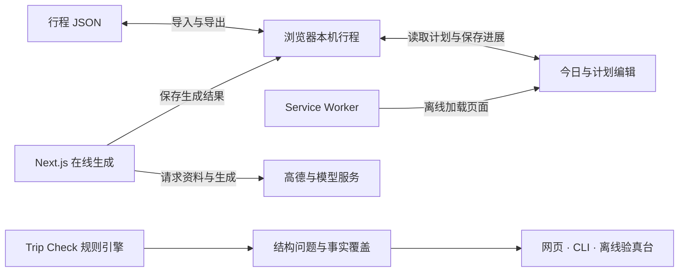

# AI Travel Companion

[English](README.en.md) · [主站](https://travel-planner-demo.onrender.com) · [离线验真台](https://1z5.github.io/AI-Travel-Companion/)

一个可自托管的旅行工具。出发前按目的地、日期和偏好生成计划，旅途中打开「今日」查看下一站、路线和当日安排。已有行程也可以直接检查。

- **规划与行中**支持按天查看和调整、地图导航、分享和日历导出。
- **Trip Check 行程体检**分开呈现时间、顺序等结构问题和事实核验覆盖情况。同一文档与规则版本可复算同一凭据。CLI、API 和离线验真台共用规则引擎。
- **数据边界**。在线地点、营业时间和路线资料来自高德开放平台，覆盖视城市和接口而定。本机行程还可展示文件附带的资料。请按场所公告确认临时变更。持普通分享链接的人可以查看行程，部分行程也可编辑。

## 试玩东京行程

首页点「开始随走」可直接记录地点、照片和文字。也可以打开东京步行示例试用导航和打卡，示例日期取东京当地的今天。行程页可以下载供分享的计划，含进展的私人备份可用于恢复手记、打卡及主动附上的位置。

编辑东京或巴黎计划时可以从内置城市包添加站点。「今日」显示地点出处，并统计有开放时间资料的站点数。资料来自场所或区政府公开页面，随行程文件保存。本机行程可下载日历，带时区的行程按目的地当地时间导出。

展开「离线行程体检」可检查日程结构，并用内置城市包核对匹配站点。旅行者在文件中填写的开放时间和路线估算仍可作参考。体检只把城市包可判定的资料计入核验覆盖。

使用生产构建时，先联网点「准备离线打开」，再断网重开本机行程，标记一站已到达。下面的动图取自 Chrome 手机视口实测，最后一帧在断网状态下再次打开，已到达的浅草寺仍保留在记录里。外部导航由地图应用处理。[生产运行方式](docs/DEPLOY.md)


## 架构一览

下图展示本机模式的主要数据流。在线生成按部署配置开启，Trip Check 可独立运行。



- **断网后仍能走行程**。计划和到达记录保存在浏览器，Service Worker 缓存页面和静态资源。行程可以导出备份。
- **核验结论可复算**。规则引擎分别报告时间、顺序等结构问题与事实覆盖，同一文档和规则版本可复算凭据。
- **长行程可逐日查看**。在线生成先检索候选地点，再把长行程按天生成，通过任务状态按天序交付已完成的部分。

## 在本地运行

使用 Node.js 22 或以上版本。

```bash
npm ci
npm run db:generate
cp .env.example .env
npm run dev
```

打开 <http://localhost:3000>。没有模型或地图密钥时，可以查看内置示例、运行离线核验，并用 `npm run gate` 验证桩服务下的完整流程。要生成行程，在 `.env.local` 中配置 `LLM_BASE_URL`、`LLM_MODEL`、`LLM_API_KEY`。需要在线地图数据时再配置 `AMAP_WEB_SERVICE_KEY`。

在生成结果或分享页点击「下载行程文件」，然后从「我的行程」导入 JSON，即可在当前设备打开完整计划和「今日」。PDF 通过浏览器打印保存。请保留文件作为备份。

本机优先模式将行程、手动编辑和到达记录保存在浏览器。部署时可使用内存暂存在线任务，服务重启只影响尚未保存的任务。持久部署、数据库迁移与自托管步骤见[部署指南](docs/DEPLOY.md)。

## 项目文档

- [文档索引](docs/README.md) · [架构](docs/ARCHITECTURE.md) · [HTTP API](docs/API.md)
- [Trip Check 标准](docs/TRIP-CHECK-STANDARD.md) · [MCP 接入](mcp/README.md)
- [贡献指南](CONTRIBUTING.md) · [变更记录](CHANGELOG.md) · [安全报告](SECURITY.md)

源码采用 [Apache-2.0](LICENSE)。第三方组件与数据来源见 [NOTICE.md](NOTICE.md)。
