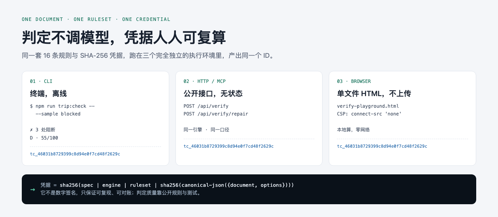

# travel-planner — AI 行程的可复算机械验真（附完整参考实现）

[](https://github.com/1z5/travel-planner/actions/workflows/ci.yml)
[](LICENSE)
[](#快速开始完整-web-应用)

> [English](README.en.md) · [在线演示](https://travel-planner-demo.onrender.com) · [架构总览](docs/ARCHITECTURE.md) · [开放标准](docs/TRIP-CHECK-STANDARD.md)



大模型三分钟就能生成一份行程，但没人对「它排得对不对」负责。这个仓库给出一种工程回答：

**把行程变成一份结构化文档，用 16 条确定性规则（不调模型）判它走不走得通，
并签发一个任何人都能独立复算的凭据 ID。** 判定不带随机性、不依赖当前时间、不联网——
同一份文档 + 同一规则版本，在你的机器上和我的机器上算出同一个结果。

> 项目定位：个人开源项目，**既是 GitHub 作品，也是作者自己每天用的工具**。
> 不商业化、不提供商业服务。主站部署在 Render + 外部 Postgres（行程不随重启丢失）；
> 手机上的日常入口是**纯静态验真台**（零冷启动、可加到主屏、断网可用）。

## 30 秒验证一次

```bash
npm install
npm run trip:check -- --sample blocked
```

输出（节选）：

```
✗ [阻断] TC-C102 两段时间重叠    「苏州博物馆」09:00-12:00 与「平江路」11:30-13:00 重叠 30 分钟
✗ [阻断] TC-F204 营业时间对不上  「苏州博物馆」安排在 2026-11-02（周一），当天闭馆
✗ [阻断] TC-F202 地点未命中      「金鸡湖美术馆」在事实源中查不到
i [提示] TC-C104 缺少真实路段数据  2/2 段相邻点位没有通勤耗时，时间接不接得上无法判断

结构自洽性  D · 55/100      事实核验  部分核验（POI 2/3 命中 · 路段 0/2）
凭据  tc_46031b8729399c8d94e0f7cd48f2629c   ← 同一文档+口径，任何人重跑都是这个 ID
```

再加 `--fix`：只做有数据依据的机械修复（顺延时间轴 / 删同天重复），
输出**修复前后两张凭据**——改了什么、风险降了多少，全部可对账。

```bash
npm run trip:check -- --sample blocked --fix
# 修复前  tc_46031b87…（D · 55） → 修复后  tc_ffb2639c…（A · 100）  ↑ +45 分 · 阻断 -1
```

退出码可进 CI：`0` 通过 · `1` 有阻断问题（`--strict` 下提醒/未核验也算失败） · `2` 输入非法。
`--json` 输出机读报告；文档格式是公开的 [JSON Schema](docs/TRIP-CHECK-STANDARD.md)。

## 三种用法

| 用法               | 入口                                                    | 说明                                                                    |
| ------------------ | ------------------------------------------------------- | ----------------------------------------------------------------------- |
| **CLI**            | `npm run trip:check -- <file.json>`                     | 零 key、零网络、离线可跑；判定与修复完全确定性                          |
| **离线验真台**     | [verify-playground.html](public/verify-playground.html) | 单文件 HTML，双击即用：引擎内联、CSP 关闭一切出站请求，浏览器本地算凭据 |
| **开放 API / MCP** | `POST /api/verify` · `mcp/stdio.mjs`                    | 把任意 agent / OTA 的行程接进同一套引擎（[MCP 说明](mcp/README.md)）    |
| **完整 Web 应用**  | [演示站](https://travel-planner-demo.onrender.com)      | 从表单生成（事实先行）→ 体检 → 工作台 → 分享 → 行中模式的完整链路       |

三种接口跑同一套 `lib/verify/` 引擎，同一份文档产出**同一个凭据 ID**
（`tc_46031b87…`）——浏览器那份不是简化版，判定、修复、哈希都是同一份源码。
离线验真台可用 `#verified` / `#blocked` / `#unverified` 直接链到「已跑完」的状态；
部署后也能从演示站的 `/verify-playground.html#blocked` 打开（不调用任何 API）。

## 手机上使用

作者自己也每天在手机上用，所以这一层是认真做的，不是「桌面站碰巧能打开」：

- **现在就能打开的公网入口**：<https://trip-check-verifier.app.workbuddy.host/?sharecode=EG2RWDAJZG>
  （纯静态托管，无实例、不休眠、秒开）
- **长期入口**：启用 GitHub Pages 后是 `https://1z5.github.io/travel-planner/`
  （`.github/workflows/pages.yml` 自动发布，改了验真台就自动更新）
- 手机浏览器「添加到主屏」→ 全屏独立启动；Service Worker 缓存导航文档，**断网也能打开**；
- 行程文档不会离开手机：CSP 写死 `connect-src 'none'`，判定/修复/凭据全在本地算；
- `#blocked` 可以直接链到一份「已经跑完、查出 3 个阻断问题」的结果。

需要生成新行程、看工作台或行中模式时再开主站：Render 免费实例会休眠（有
`keep-warm` 每 5 分钟保活），但行程存在外部 Postgres 里，**重启不会丢**。
部署细节见 [DEMO.md](docs/DEMO.md)。

## 这个仓库展示什么

| 主题       | 具体做法                                                                                                  | 从哪看                                                                                                                                   |
| ---------- | --------------------------------------------------------------------------------------------------------- | ---------------------------------------------------------------------------------------------------------------------------------------- |
| 确定性判定 | 16 条纯函数规则 + 两轴报告，判定不调模型；同一输入 + 同一引擎/规则版本 → 同一凭据 ID，第三方可独立复算    | `lib/verify/*` · [开放标准](docs/TRIP-CHECK-STANDARD.md)                                                                                 |
| 可复算凭据 | canonical JSON + SHA-256，口径写死在公开文档；CLI / API / MCP 三处跑出同一个 ID                           | `lib/verify/credential.ts`（86 行）                                                                                                      |
| 可撤销修复 | 只做机械修复（顺延时间 / 删同天重复），预览 → 确认写入，`revision+1` 乐观并发，签发前后凭据链             | `lib/verify/repair.ts` · [ADR-005](docs/adr/005-deterministic-fix.md) · [ADR-013](docs/adr/013-trip-check-repair.md)                     |
| 长任务编排 | 2–4 分钟的推理做成异步 Job + 心跳自愈；≥5 天走「大纲 → 并发 3 路分日生成 → 逐日校验 → 前缀发布」          | `lib/jobs/jobs.ts` · `lib/plan/planner.ts` · [ADR-001](docs/adr/001-async-jobs.md) · [ADR-004](docs/adr/004-streaming-multi-day.md)      |
| 幻觉治理   | 生成前注入高德事实；POI 三态 `hit/miss/error`；没查过就写 `unverified`，不猜、不伪造核验状态              | `lib/plan/grounding.ts` · `lib/geo/amap.ts` · [ADR-002](docs/adr/002-poi-three-state.md) · [ADR-006](docs/adr/006-ground-truth-first.md) |
| 存储抽象   | 同一 Store 接口的 memory / postgres 双实现，静态 fixture 兜底，统一读入口 `resolvePlan`                   | `lib/store/` · `lib/plan/plan-repo.ts` · `prisma/schema.prisma`                                                                          |
| 契约化工程 | 33 条 API 路由、单测 + 自建 e2e 编排（4 个桩 / 隔离端口 / 文件锁）、CI 三 job、pre-commit / pre-push 钩子 | [架构总览](docs/ARCHITECTURE.md) · [贡献指南](CONTRIBUTING.md)                                                                           |
| 前端       | ATLAS v6 双主题设计系统、React 19 View Transitions、CSS scroll-driven 进度线，零新增依赖                  | `app/styles/` · [设计文档](docs/design/ATLAS-V6.md)                                                                                      |

## 快速开始（完整 Web 应用）

```bash
cp .env.example .env   # 不配 key 也能跑通 MOCK 全链路；LLM_* 需填才能真生成
npm install
npx prisma generate    # Prisma 7 起必须手动执行
npm run dev            # http://localhost:3000
```

想秒开一份完整成品（不调 LLM、不用 key）点首页「看一份验真过的成品」。
拿到高德 key 后可用 `npm run verify:amap` 做 5 秒的 POI / 通勤验收。

## 推荐阅读路径（20 分钟）

1. [docs/TRIP-CHECK-STANDARD.md](docs/TRIP-CHECK-STANDARD.md) — 开放标准本体（文档格式 / 凭据口径 / 三态语义）
2. [lib/verify/engine.ts](lib/verify/engine.ts) — 判定引擎，648 行纯函数
3. [lib/verify/rules.ts](lib/verify/rules.ts) — 16 条规则的注册表与扣分口径
4. [lib/verify/credential.ts](lib/verify/credential.ts) — 可复算凭据，86 行
5. [docs/ARCHITECTURE.md](docs/ARCHITECTURE.md) §7 — 已知技术债（诚实清单，不假装仓库是干净的）
6. [ADR-001](docs/adr/001-async-jobs.md) / [004](docs/adr/004-streaming-multi-day.md) / [005](docs/adr/005-deterministic-fix.md) — 长任务 / 分日流式 / 确定性修复的取舍

## 测试与门禁

```bash
npm run gate          # 一键验收：typecheck + lint + format + 单测 + e2e
npm run test:unit     # Vitest 单测
npm test              # e2e：自起 4 个桩 + 隔离 dev server，不需要外部服务
npm run gate:visual   # 视觉 / 可访问性回归
npm run check:env     # 环境变量体检
```

**文档不写死测试条数**：以 `npm run gate` 实测为准，CI 每次 push 会跑完整链路。
当前 `lint` 为 0 error / 60 条存量 warning，成因与明细见 [架构总览 · 已知技术债](docs/ARCHITECTURE.md#已知技术债)。

## 目录导览

```
cli/             Trip Check CLI（零 key 离线验真 + 确定性修复）
app/
  (app)/         产品路由：首页 / 新建 / 验真台 / 工作台 / 分享 / 行中 / 报告
  (marketing)/   关于 / 城市模板 / 隐私 / 条款 / 开放核验体验台
  api/           33 条路由：生成任务、验真开放 API、认证、地图天气代理、埋点
  styles/        ATLAS v6 设计系统分片（globals.css 冻结，覆盖层后写者胜）
lib/
  plan/ jobs/    生成链路：规划 / 异步任务 / 事实注入 / 校验
  verify/        Trip Check：引擎 / 规则 / 凭据 / 修复 / OpenAPI / MCP / JSON Schema
  store/         memory + postgres 双实现
  geo/ auth/ server/   外部数据与合规、认证、API 基础设施
components/      工作台、PlanView、行中视图、体检报告、分享动作
prisma/          5 个 model：Job / Plan / QuotaBucket / SmsCode / TripEvent
tests/           Vitest 单测
scripts/         e2e 编排、桩服务、CLI 启动器、部署与验收脚本
docs/            架构总览、开放标准、17 篇 ADR、设计系统、安全审计、历史归档
```

## 已知边界（有意为之）

- 凭据是可复算哈希，**不是数字签名**，不构成对真实世界的背书；`unverified` 不等于「没问题」。
- 高德数据按协议不建事实库；本项目不用于商业用途，也不主张任何数据许可。
- 主站持久化依赖外部 Postgres（连接串失效会写失败，不静默退化成内存）；
  免费实例会休眠但行程不丢；分享 token 即能力（未做账号体系）；配额按实例内存计数。
- 通勤是驾车距离矩阵估算，不是真实公交 / 地铁路线；地图只画顺序连线，不冒充导航。
- 生成慢（≤4 天 3–4 分钟，≥5 天分日流式），靠异步任务 + 进度 + 配额退还兜住体验。
- 没有错误监控，失败只落 console；这不是生产级可观测性。

## 许可与贡献

[Apache-2.0](LICENSE)（Copyright © 2026 1z5）· 第三方声明 [NOTICE.md](NOTICE.md) ·
[贡献指南](CONTRIBUTING.md) · 安全漏洞请走 [SECURITY.md](SECURITY.md) 的私密渠道。

这是个人技术展示项目，欢迎 issue / 讨论，但**不保证接受 PR，也不提供维护承诺**。
